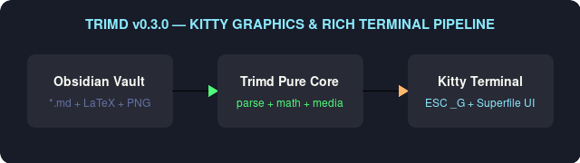
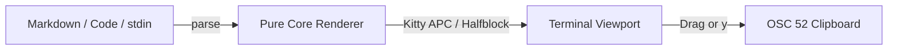
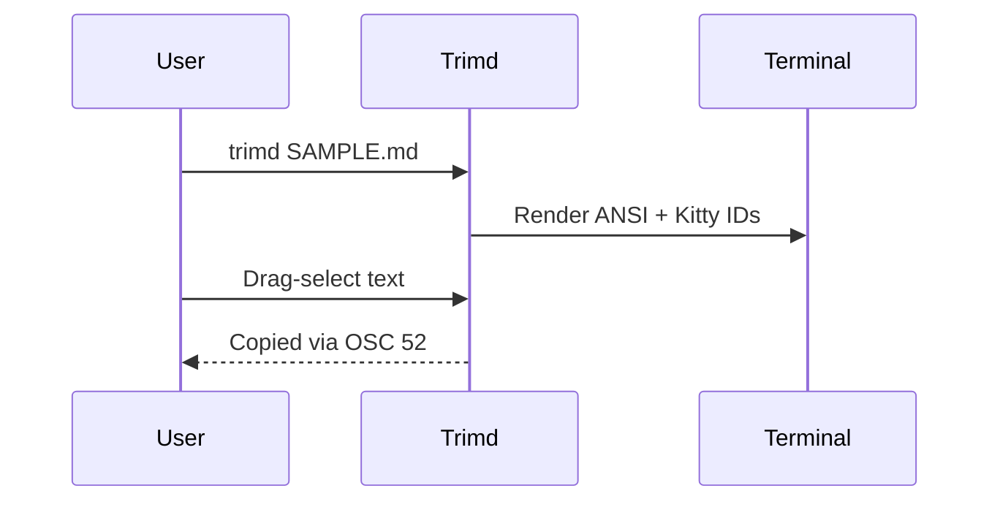

# Welcome to Trimd 8-)

Hey there! If you are reading this inside **Trimd**, you are looking at a live terminal Markdown, Obsidian, and code viewer built to keep your hands on the keyboard (or mouse!) without leaving your terminal or SSH session.

> [!TIP] Quick Controls While You Read
> - Press `T` to cycle themes (`tokyo-night`, `dracula`, `default`, `light`, `plain`).
> - Press `i` to toggle graphics mode (`kitty` ↔ `halfblock` ↔ `none`).
> - Press `m` to expand/collapse the YAML frontmatter card above.
> - Press `/` to search, `o` for the heading outline, `f` for keyboard link hints, or `?` for the full keymap.
> - **Click & drag** any text in this pane to highlight and auto-copy it to your clipboard over **OSC 52** (works seamlessly over SSH & `tmux`!).

---

## 1. Typography, Emphasis & Inline Formatting

Trimd enables smart typographic replacements out of the box, turning plain ASCII punctuation into crisp symbols:

- Symbols: (c) (r) (tm) +- and ellipses... plus em-dashes --- and en-dashes --
- Smart quotes: "Double quotes" and 'single quotes'
- Emphasis: **Bold text**, *italic text*, ~~strikethrough~~, ++inserted text++, and ==highlighted text==
- Scientific notation: Water is H~2~O and this is the 19^th^ century
- Classic emojis: :wink: :laughing: :yum: or shortcuts like `8-)` and `;)`

---

## 2. Nested Blockquotes & Callouts

Blockquotes keep their vertical `│` bars cleanly across wrapped lines and nested levels:

> Level 1: Great for quoting documentation or design notes.
>> Level 2: Nested quotes stack cleanly with double borders.
> > > Level 3: Even deeply nested commentary stays readable at any terminal width.

For structured notes, Trimd supports both **Obsidian Callouts** and **Custom Containers**:

> [!NOTE] Pure Core Rendering
> Trimd parses Markdown, LaTeX, Mermaid diagrams, and syntax highlighting into pure ANSI lines before Ink renders the TUI.

> [!WARNING] Terminal Graphics & SSH
> Running over SSH without `KITTY_WINDOW_ID`? Press `i` to switch between `kitty` and truecolor `halfblock` mode anytime.

::: warning
*Custom `:::` containers* also render as styled callout surfaces!
:::

---

## 3. Lists & Interactive Checklists

Mix unordered bullets, ordered steps, and Obsidian-style task lists:

- Unordered lists indent 2 spaces per level:
  - Sub-items align cleanly under their parent
    * Even when marker styles (`-`, `+`, `*`) change
- Ordered lists:
  1. Open any file (`trimd README.md`) or pipe stdin (`cat notes.md | trimd`)
  2. Highlight code with `--lang` (`trimd app.ts` or `cat script.py | trimd`)
  3. Navigate your vault using the sidebar (`Tab` or `←`/`→`)

Task checklist:
- [x] Full-width Lualine status bar & Bufferline tab chrome
- [x] Mouse drag-to-copy via `OSC 52` (local & SSH)
- [x] Smooth cached Kitty graphics & Unicode Mermaid diagrams
- [ ] Try pressing `f` to jump to any link using keyboard hints!

---

## 4. Syntax-Highlighted Code & One-Click Copy

Every fenced code block gets line numbers, language detection, and a clickable **`[Copy]`** button in the top-right corner (or press `y` to copy the nearest block):

```ts
// TypeScript with theme-aware highlighting
export function greetTrimd(user: string, overSsh = false): string {
  const mode = overSsh ? 'OSC 52 clipboard' : 'native terminal';
  return `Welcome, ${user}! Running smoothly with ${mode}.`;
}
```

Even unlabeled fences auto-detect their language:

```
#!/usr/bin/env bash
cat SAMPLE.md | trimd --theme tokyo-night
```

And inline `code` stands out cleanly inside prose.

---

## 5. Tables (Left & Right Aligned)

Tables render with rounded Unicode borders (`╭─┬─╮`) and automatically wrap long cells so nothing gets truncated with `…`:

| Shortcut | Action | Context |
| -------- | ------ | ------- |
| `↑` / `↓` or `j` / `k` | Scroll line by line | Document / Sidebar |
| `←` / `→` | Switch focus between panes | Split view |
| `f` | Show keyboard link hints | Document |
| `p` | Peek wikilink target in a floating modal | Document |

Right-aligned numeric columns work too:

| Metric | Target | Status |
| ------:| ------:| ------:|
| Startup | < 80 ms | Pass |
| Tests | 300+ | Pass |
| Dependencies | Minimal | Pass |

---

## 6. Links, Obsidian Wikilinks & Embeds

Trimd connects your local notes and external references together:

- Standard web links: [Trimd on GitHub](https://github.com) or auto-linked https://obsidian.md
- Resolved wikilinks (click or use `f` to navigate, `p` to peek): [[README]] and [[README|Project README]]
- Unresolved wikilinks safely show a dim warning instead of crashing: [[NonExistent_Note]]
- Inline Obsidian tags: #trimd/v0.3 #terminal/tui #markdown
- Note embeds inline a clean preview card:

![[README]]

---

## 7. Local & Remote Images

Trimd renders both **local relative paths** and **remote URLs** inline using either the **Kitty Graphics Protocol** (with ID caching for smooth scrolling) or **24-bit Truecolor Half-Blocks** (`▀`).

Local asset (`test/fixtures/sample-diagram.png`):



Obsidian-style image embed:

![[sample-diagram.png]]

Remote image over HTTPS:


---

## 8. Mermaid Diagrams (Flowcharts & Sequence Diagrams)

Mermaid blocks render as crisp Unicode box-and-arrow diagrams in **all** graphics modes (`kitty`, `halfblock`, and `unicode`):



Sequence diagrams are supported too:



---

## 9. LaTeX & Mathematical Expressions

Inline math like Euler's identity $e^{i\pi} + 1 = 0$, complexity $\mathcal{O}(n \log n)$, Greek implications $\alpha \to \beta \implies \gamma \le \delta \neq \infty$, and fractions $\frac{-b \pm \sqrt{b^2 - 4ac}}{2a}$ render as clean Unicode math.

Display math blocks (`$$...$$`):

$$
\sum_{i=1}^{n} x_i = \int_{0}^{1} f(x)\,dx \quad \text{where } \nabla \cdot \mathbf{E} = \frac{\rho}{\varepsilon_0}
$$

Fenced `math` blocks:

```math
\forall x \in \mathbb{R}, \quad \lim_{n \to \infty} \left(1 + \frac{x}{n}\right)^n = e^x
```

---

## 10. Extended Markdown Extras

- **Footnotes:** Reference a note[^1] or write one inline^[Inline footnotes expand automatically at the bottom of the document.].
- **Abbreviations:** Hover-free expansion of terms like HTML and CSS in prose.

*[HTML]: Hyper Text Markup Language
*[CSS]: Cascading Style Sheets

- **Definition Lists:**

Trimd
: A fast, terminal-native Markdown and Obsidian reader with mouse support, themes, and graphics.

Kitty Graphics Protocol
: High-resolution terminal image protocol using `\x1b_G` APC sequences with image ID caching.

[^1]: Footnotes support **rich formatting** and automatically link back from the footer.
