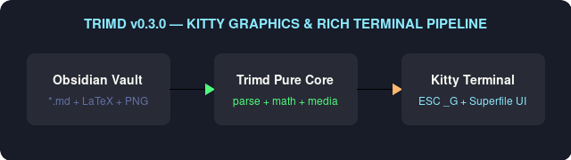
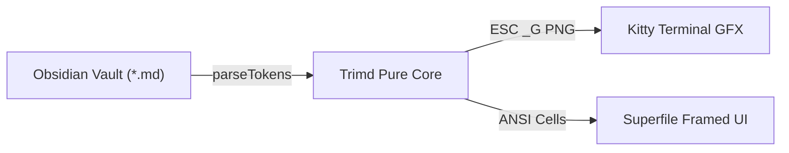

# h1 Heading 8-)
## h2 Heading
### h3 Heading
#### h4 Heading
##### h5 Heading
###### h6 Heading


## Horizontal Rules

___

---

***


## Typographic replacements

Enable typographer option to see result.

(c) (C) (r) (R) (tm) (TM) +-

test.. test... test..... test?..... test!....

!!!!!! ???? ,,  -- ---

"Smartypants, double quotes" and 'single quotes'


## Emphasis

**This is bold text**

__This is bold text__

*This is italic text*

_This is italic text_

~~Strikethrough~~


## Blockquotes


> Blockquotes can also be nested...
>> ...by using additional greater-than signs right next to each other...
> > > ...or with spaces between arrows.


## Lists

Unordered

+ Create a list by starting a line with `+`, `-`, or `*`
+ Sub-lists are made by indenting 2 spaces:
  - Marker character change forces new list start:
    * Ac tristique libero volutpat at
    + Facilisis in pretium nisl aliquet
    - Nulla volutpat aliquam velit
+ Very easy!

Ordered

1. Lorem ipsum dolor sit amet
2. Consectetur adipiscing elit
3. Integer molestie lorem at massa


1. You can use sequential numbers...
1. ...or keep all the numbers as `1.`

Start numbering with offset:

57. foo
1. bar


## Code

Inline `code`

Indented code

    // Some comments
    line 1 of code
    line 2 of code
    line 3 of code


Block code "fences"

```
Sample text here...
```

Syntax highlighting

``` js
const foo = function (bar) {
  return bar++;
};

console.log(foo(5));
```

## Tables

| Option | Description |
| ------ | ----------- |
| data   | path to data files to supply the data that will be passed into templates. |
| engine | engine to be used for processing templates. Handlebars is the default. |
| ext    | extension to be used for dest files. |

Right aligned columns

| Option | Description |
| ------:| -----------:|
| data   | path to data files to supply the data that will be passed into templates. |
| engine | engine to be used for processing templates. Handlebars is the default. |
| ext    | extension to be used for dest files. |


## Links

[link text](http://dev.nodeca.com)

[link with title](http://nodeca.github.io/pica/demo/ "title text!")

Autoconverted link https://github.com/nodeca/pica (enable linkify to see)


## Images




Like links, Images also have a footnote style syntax

![Alt text][id]

With a reference later in the document defining the URL location:

[id]: https://octodex.github.com/images/dojocat.jpg  "The Dojocat"


## Plugins

The killer feature of `markdown-it` is very effective support of
[syntax plugins](https://www.npmjs.org/browse/keyword/markdown-it-plugin).


### [Emojies](https://github.com/markdown-it/markdown-it-emoji)

> Classic markup: :wink: :cry: :laughing: :yum:
>
> Shortcuts (emoticons): :-) :-( 8-) ;)

see [how to change output](https://github.com/markdown-it/markdown-it-emoji#change-output) with twemoji.


### [Subscript](https://github.com/markdown-it/markdown-it-sub) / [Superscript](https://github.com/markdown-it/markdown-it-sup)

- 19^th^
- H~2~O


### [\<ins>](https://github.com/markdown-it/markdown-it-ins)

++Inserted text++


### [\<mark>](https://github.com/markdown-it/markdown-it-mark)

==Marked text==


### [Footnotes](https://github.com/markdown-it/markdown-it-footnote)

Footnote 1 link[^first].

Footnote 2 link[^second].

Inline footnote^[Text of inline footnote] definition.

Duplicated footnote reference[^second].

[^first]: Footnote **can have markup**

    and multiple paragraphs.

[^second]: Footnote text.


### [Definition lists](https://github.com/markdown-it/markdown-it-deflist)

Term 1

:   Definition 1
with lazy continuation.

Term 2 with *inline markup*

:   Definition 2

        { some code, part of Definition 2 }

    Third paragraph of definition 2.

_Compact style:_

Term 1
  ~ Definition 1

Term 2
  ~ Definition 2a
  ~ Definition 2b


### [Abbreviations](https://github.com/markdown-it/markdown-it-abbr)

This is HTML abbreviation example.

It converts "HTML", but keep intact partial entries like "xxxHTMLyyy" and so on.

*[HTML]: Hyper Text Markup Language

### [Custom containers](https://github.com/markdown-it/markdown-it-container)

::: warning
*here be dragons*
:::


## LaTeX & Mathematical Expressions

Inline math expressions: Euler's identity $e^{i\pi} + 1 = 0$, algorithmic bound $\mathcal{O}(n \log n)$, Greek implications $\alpha \to \beta \implies \gamma \le \delta \neq \infty$, and quadratic root $\frac{-b \pm \sqrt{b^2 - 4ac}}{2a} \approx 1.618$.

Display math block (`$$...$$`):

$$
\sum_{i=1}^{n} x_i = \int_{0}^{1} f(x)\,dx \quad \text{where } \nabla \cdot \mathbf{E} = \frac{\rho}{\varepsilon_0}
$$

Fenced math block:

```math
\forall x \in \mathbb{R}, \quad \lim_{n \to \infty} \left(1 + \frac{x}{n}\right)^n = e^x
```


## Mermaid Diagrams




## Obsidian Dialect & Interactive Features

> [!NOTE] Architecture Invariant (`ADR-005`)
> Core pipeline under `src/core/` remains 100% pure and free of TUI imports while rendering math, Mermaid diagrams, and Kitty graphics payloads.

> [!WARNING] Terminal Graphics Verification
> Launch `trimd test_markdown.md` inside `kitty` to verify inline PNG rendering, framed Superfile sidebar icons, and floating `p` / `o` overlays.

### Wikilinks, Embeds, Tags & Task Lists

- Resolved wikilinks: [[README]] and [[08_Roadmap|UX/UI Roadmap]]
- Unresolved wikilink (must show dim warning icon, never crash): [[NonExistent_Future_Spec]]
- Embedded note preview: ![[00_Project_Charter]]
- Embedded local image: ![[sample-diagram.png]]
- Inline tags: #obsidian/vault #terminal/kitty #release/v0.3.0
- [x] Verify Superfile framed sidebar with distinct folder (`📁`) and file (`📄`/`📘`/`📐`) icons
- [x] Verify inline `$...$` and block `$$...$$` LaTeX math rendering without raw `$` delimiters
- [ ] Verify live `kitty` screenshot capture for final production go/no-go sign-off
